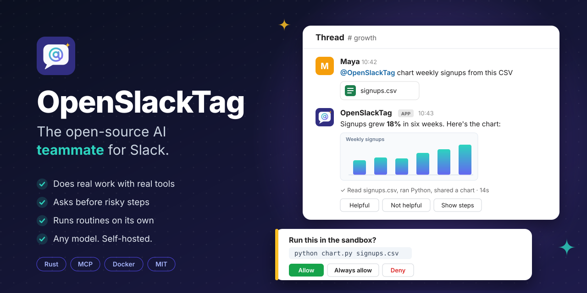

<p align="center"></p>

# OpenSlackTag

An open-source AI teammate for Slack. Mention it with a task. It does the work with real tools and replies in the thread with the result.

```
you        @OpenSlackTag what changed in our deploy process this month? update the wiki
teammate   Reading #releases…
           Deploys now go through the `release` workflow instead of manual tags (since Oct 3, <link|PR #412>).
           Rollbacks use `make rollback`. I updated *processes/deploys* in the wiki.
           ✓ Read #releases, searched the wiki and 2 more · claude-sonnet-4-5 · 14s
           [👍] [👎] [Show steps]
```

**Does the work**
- It reads channels and threads, searches the web, and fetches pages.
- It runs Python and shell on its own sandboxed computer, so it can make spreadsheets, charts and Word or PowerPoint files and post them in the thread.
- It generates images.
- It uses anything you connect over MCP: GitHub, Linear, a browser, your database.

**Asks before risky steps**
- Allow, ask and deny rules decide which tools need approval. Approval cards in the thread offer *Allow*, *Always allow* and *Deny*.
- Only the person who asked, or the approvers you name, can click them.

**Works on its own**
- Routines run on a schedule, for example "every weekday at 09:00, post a standup digest".
- Watches run when a channel gets a new message, for example "when someone posts an error in #alerts, look into it".
- Once a week it suggests automations based on what people keep asking for.

**Remembers your team**
- It keeps a Markdown wiki of processes, decisions and owners. Every page has a version history.
- You can give it standing instructions, per-channel instructions, and Agent Skills (`SKILL.md` playbooks).

**Reads what you share**
- It reads files, images and ZIP archives posted in the thread.

**Any model**
- Anthropic natively, plus anything that speaks the OpenAI API: OpenAI, OpenRouter, Groq, DeepSeek, Ollama, LM Studio and vLLM.

**Long tasks stay sharp**
- Each thread's full transcript, tool calls included, is kept. When it outgrows the context budget, older turns are compacted into a structured handoff note.
- It can split big jobs across up to 8 helpers that run in parallel.

**Steerable**
- Reply while it's working ("actually, only the last week") and it folds that into the running task.
- Say `stop` to cancel it.

**Accountable**
- Each answer says what it did, which model it used and how long it took. 👍 and 👎 feedback is recorded.
- An audit log records every tool call: who asked, what ran, and how it ended.
- Token usage is tracked per day and model.

**Easy to run**
- One binary or one `docker compose up`.
- Socket Mode means no public URL and no webhooks.
- `setup` creates the Slack app from a prefilled manifest, and `doctor` tells you exactly what's broken.

## Quick start

### With Docker (recommended)

This needs only [Docker](https://docs.docker.com/get-docker/).

```bash
git clone https://github.com/nettanvirdev/OpenSlackTag
```

```bash
cd OpenSlackTag
```

```bash
docker compose build
```

```bash
docker compose run --rm openslacktag setup
```

```bash
docker compose up -d
```

Setup asks for your model provider and key, then gives you a link to Slack's "create app" page with everything filled in. You install the app, paste two tokens, and setup writes `.env`.

`docker compose up -d` starts the teammate and restarts it after reboots. Settings and data (`.env`, `mcp.json`, `data/`) stay in this folder.

Then invite it to a channel (`/invite @OpenSlackTag`) and mention it. You can also DM it.

| Task | Command |
|---|---|
| Watch the logs | `docker compose logs -f` |
| Check everything | `docker compose run --rm openslacktag doctor` |
| Update | `git pull`, then `docker compose up -d --build` |

The image includes Node, so `npx` MCP servers work out of the box.

### From source

You need [Rust](https://rustup.rs) 1.88 or newer.

```bash
cargo install --path . --locked
```

```bash
openslacktag setup
```

```bash
openslacktag slack
```

Prebuilt binaries for Linux, macOS and Windows are attached to each [release](https://github.com/nettanvirdev/OpenSlackTag/releases).

### Try it without Slack

```bash
openslacktag chat
```

This uses the same engine and tools, in your terminal. With Docker, run `docker compose run --rm openslacktag chat` instead.

## Using it

| You say | It does |
|---|---|
| `@OpenSlackTag summarise #support from this week` | Reads the channel and answers in the thread |
| *(in the thread)* `only the billing ones` | Folds that into the running task |
| `stop` | Cancels the task |
| *(attach a CSV)* `chart signups per week` | Runs Python in its sandbox and posts the chart |
| `every weekday at 09:00 post a digest of #eng here` | Creates a routine in this channel |
| `when someone posts in #alerts, check if it's a known issue` | Watches the channel and replies in the message's thread, or stays quiet |
| `what routines do we have?` / `move the digest to 10:00` | Lists and edits routines |
| `remember that Priya owns billing` | Writes it to the wiki |
| `make a logo sketch for the hackathon` | Generates an image and shares it |

Routine times accept these forms:
- `in 2h`, `every 30m`
- `every day at 09:00`, `every weekday at 17:30`, `every monday,thursday at 10:00`
- any cron expression, in your time zone

Watches are capped at 30 runs an hour, so a busy channel can't run up a bill.

## Commands

| Command | What it does |
|---|---|
| `openslacktag setup` | Guided setup: model, Slack app, sandbox. Writes `.env`. |
| `openslacktag slack` | Runs the teammate in Slack. |
| `openslacktag chat` | Talks to the teammate in the terminal. `/new` starts over, `/quit` leaves. |
| `openslacktag doctor` | Checks the model, Slack, sandbox, search, images, permissions, skills and MCP servers, and says how to fix each failure. |
| `openslacktag schedules` | Lists routines and watches. `schedules cancel <id>` removes one. |
| `openslacktag usage [days]` | Token usage per day and model. |
| `openslacktag audit [count]` | The last tool calls: who asked, what ran, how it ended. |
| `openslacktag suggest [days]` | Suggests automations from recent conversations. |

## Configuration

Everything lives in `.env` in the folder you run from. [.env.example](.env.example) documents every setting.

| Variable | Default | Meaning |
|---|---|---|
| `LLM_PROVIDER` | `openai` (`anthropic` for Anthropic's URL) | `anthropic`, or `openai` for any OpenAI-compatible API |
| `LLM_BASE_URL` | the provider's official API | e.g. `http://localhost:11434/v1` for Ollama |
| `LLM_API_KEY` | | Your provider key (not needed for local models) |
| `LLM_MODEL` | | Model id, e.g. one that `setup` lists |
| `SLACK_BOT_TOKEN` | | `xoxb-…` from *OAuth & Permissions* |
| `SLACK_APP_TOKEN` | | `xapp-…` app-level token with `connections:write` |
| `ALLOWED_USERS` | everyone in the workspace | Comma-separated user ids allowed to use the teammate |
| `APPROVERS` | whoever asked | User ids allowed to approve tools that ask first |
| `PERMISSIONS` | `permissions.json` | Allow, ask and deny rules (see below) |
| `SEARCH_PROVIDER` | off | `brave`, `tavily` or `searxng` (with `SEARCH_API_KEY` or `SEARCH_URL`) |
| `IMAGE_MODEL` | off | Turns on `generate_image`. `IMAGE_BASE_URL` and `IMAGE_API_KEY` default to the chat provider's. |
| `SANDBOX_IMAGE` | off | Docker image for `run_shell`, e.g. `openslacktag-sandbox` |
| `SANDBOX_NETWORK` | `none` | `bridge` gives the sandbox network access (see Safety) |
| `SKILLS_DIR` | `skills` | Folder of Agent Skills |
| `INSTRUCTIONS` | `instructions.md` | Standing instructions for every conversation |
| `MCP_CONFIG` | `mcp.json` | MCP servers file |
| `SUGGESTIONS_CHANNEL` | off | Channel id for weekly automation suggestions (Mondays 09:00) |
| `DATA_DIR` | `data` | Wiki, transcripts, workspaces, routines and logs |
| `COMPACT_AT_TOKENS` | `80000` | When to compact a long conversation |

### Permissions and approvals

Every tool call is checked against rules. Reading and research tools are allowed by default. Posting to other channels and every MCP tool ask first. To change this, copy [permissions.example.json](permissions.example.json) to `permissions.json`:

```json
{
  "rules": [
    { "tool": "mcp", "pattern": "github_list_*", "action": "allow" },
    { "tool": "mcp", "pattern": "github_delete_*", "action": "deny" },
    { "tool": "run_shell", "pattern": "rm -rf *", "action": "deny" }
  ]
}
```

- `tool` is a tool id, or `mcp` for MCP tools.
- `pattern` matches the tool's target: the MCP tool name, the shell command, the URL, or the channel.
- Both fields accept `*` wildcards. The most specific matching rule wins.
- When a call asks first, the thread shows a card with the details and *Allow*, *Always allow* (for the rest of the thread) and *Deny*.
- A card nobody answers is denied after 15 minutes.

### MCP servers

Copy [mcp.example.json](mcp.example.json) to `mcp.json` and list your servers. It uses the same format as Claude Desktop and Cursor:

```json
{
  "mcpServers": {
    "github": {
      "command": "npx",
      "args": ["-y", "@modelcontextprotocol/server-github"],
      "env": { "GITHUB_PERSONAL_ACCESS_TOKEN": "..." }
    },
    "browser": { "command": "npx", "args": ["-y", "@playwright/mcp@latest", "--headless", "--isolated"] },
    "remote": { "url": "https://mcp.example.com/mcp", "headers": { "Authorization": "Bearer ..." } }
  }
}
```

Their tools show up as `<server>_<tool>`. A server that fails to start is reported and skipped, so it never takes the bot down. The `browser` entry gives the teammate a real browser for pages that need JavaScript or a login flow.

### Skills and instructions

- **Skills.** Put Agent Skills in `skills/<name>/SKILL.md`. The teammate sees each skill's name and description, and reads the full playbook when a task matches. [examples/skills](examples/skills) has a weekly report, an incident summary and a standup digest.
- **Instructions.** `instructions.md` is added to every conversation: house style, key channels, things never to do. See [examples/instructions.md](examples/instructions.md).
- **Per-channel instructions.** Tell the teammate in a channel ("in this channel, always answer in Spanish"). It keeps them in the wiki page `channels/<id>`.

### The sandbox

With `SANDBOX_IMAGE` set, the teammate gets `run_shell`. Every command runs in a fresh container: `--rm`, 1 CPU, 1 GB of memory, no capabilities, no new privileges, and no network by default.

Each conversation gets its own `/work` folder that persists between commands:
- Files people share land in `inbox/`.
- Files the teammate writes can be posted to the thread with `share_file`.

[sandbox/Dockerfile](sandbox/Dockerfile) builds a good image with Python, pandas, matplotlib, the Excel, Word, PowerPoint and PDF libraries, and common command-line tools:

```bash
docker build -t openslacktag-sandbox sandbox/
```

When OpenSlackTag itself runs in Docker, add the sandbox override. It mounts the host's Docker socket; read its header first.

```bash
docker compose -f docker-compose.yml -f docker-compose.sandbox.yml up -d
```

## Safety

The teammate acts with your keys, so treat it as a colleague holding your tokens.

- **Who can use it.** Only people in your workspace. Slack Connect guests from other organisations are ignored. `ALLOWED_USERS` narrows it further, and `APPROVERS` controls who can approve risky steps.
- **Private channels stay private.** It only reads a private channel or DM for someone who is a member of it.
- **Risky tools ask first.** See [Permissions and approvals](#permissions-and-approvals). It always refuses a fourth identical call in a row.
- **Web fetches can't reach private networks.** Any URL that resolves to a loopback, private, link-local or carrier-NAT address is refused, including IPv6 forms like NAT64 and 6to4. The check runs on every redirect hop. The checked address is pinned against DNS rebinding, and proxies are bypassed.
- **The shell only runs in Docker,** never on the host. With `SANDBOX_NETWORK=none` (the default) the container has no network at all. With `bridge` it can reach anything the host can, including your LAN and cloud metadata endpoints, so only use `bridge` where that's acceptable.
- **The Docker socket is powerful.** The Docker deployment's sandbox override gives the teammate the host's Docker socket. That is root-equivalent on the host, so run it on a machine dedicated to it.
- **No channel-wide pings.** Replies are escaped for Slack, so only user mentions, channel links and web links survive. `@channel`, `@here` and group mentions never fire, whatever a fetched page says.
- **Shared files are contained.** Downloads and ZIP archives are unpacked only inside the conversation's workspace. Paths that try to escape are dropped, and archive sizes are capped.
- **One shared wiki.** It's plain Markdown in `DATA_DIR`, shared by every channel. Something learned in a private channel can surface elsewhere, and text someone plants there persists. Review it like any shared doc. The history keeps the last 20 versions of each page, and the teammate is told never to store secrets.
- **Everything is logged locally.** `data/audit.jsonl` records every tool call, and `data/usage.jsonl` records every model call. Nothing is sent anywhere except your model provider, Slack, and the services your tools call.
- **Keys stay in `.env`.** It's git-ignored, readable only by you, and API keys are kept out of logs.

## How it works

```
Slack (Socket Mode) ──► slack.rs ──► engine.rs ──► agent loop (crates/agent)
   ▲  approval cards,      │             │               ├─► model providers (crates/provider)
   │  feedback, steps      │             │               └─► tool registry (crates/tools) ─► permission gate
   └───────────────────────┘             │                      ├─ wiki, web, shell, files, images (src/*.rs)
                                         │                      ├─ Slack tools, routines, delegate
                                         │                      └─ MCP servers (crates/mcp)
                                         └─► transcripts + compaction, usage, audit
```

| Crate | Role |
|---|---|
| `crates/core` | Shared types: messages, tools, providers, permissions, errors |
| `crates/provider` | Anthropic and OpenAI-compatible streaming clients, retries |
| `crates/agent` | The turn loop: tool calls, repeated-call guard, steering |
| `crates/tools` | The tool registry: schema validation, permission checks, output limits |
| `crates/mcp` | MCP client (stdio and HTTP) exposing servers as tools |
| `crates/mock` | Scripted model and tools for tests |

## Development

```bash
cargo test --workspace
```

The tests need no Slack workspace and no API key. `tests/e2e.rs` runs the real Slack loop against a fake Slack (Web API, file uploads and the Socket Mode WebSocket) and a scripted model. It covers:
- threaded replies, duplicate deliveries, and steering and stopping mid-task
- approval clicks by the right and wrong people
- file and image handling and uploads
- private-channel checks, routines and watches, helpers, and compaction

## Roadmap

- Acting as each user with their own OAuth tokens, instead of one shared bot identity
- Microsoft Teams
- SSO and SCIM for larger organisations
- Routines relative to calendar events ("an hour before each customer call")
- Tracking commitments made in threads ("I'll send it Friday") and following up

## License

MIT. OpenSlackTag is an independent project and is not affiliated with Slack.
